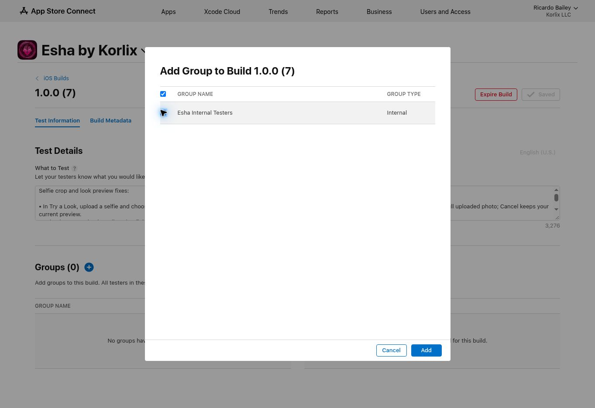

# Crop and look-selection update — build 7 ready for group approval

**Prepared and uploaded · November 15, 2026 (EST) · Esha 1.0.0 (7)**

The crop editor and look-selection correction are committed in **1.0.0+7**. All **183 Flutter tests** passed, the analyzer reports no issues, and the source identity check passed. All three cloud CI jobs passed. The signed iPhone package was independently verified and successfully uploaded to Apple. Apple processing is complete; export compliance and testing notes are saved. **TestFlight group assignment is blocked pending explicit approval**, so build 7 availability is not yet verified. UTC receipts may carry a November 16 date.

## Remaining approval

Automatic approval review rejected the final **Add** action for the existing **Esha Internal Testers** group. The stated reason was that making build **1.0.0 (7)** available to that group needed explicit authorization naming the recipients and access scope. The action was not retried. App Store Connect still shows **Groups (0)**, with the existing group selected in the pending Add Group dialog.

The requested approval is: **Make Esha 1.0.0 (7) available to the existing Esha Internal Testers group.** After approval, complete Add and verify that the group lists build 7 as **Testing**. The build's encryption declaration was saved with **France: No**, preserving the user's selection. TestFlight's What to Test notes are saved and describe crop, zoom, Reset, Cancel, Original/Try-on and style checks.

## What changes

**Crop / zoom** opens an editor for the selected selfie. Pinch or use the **Zoom** slider to bring the face closer, then drag to position it. **Reset** shows the entire uncropped photo in the editor. **Cancel** closes the editor without changing the currently applied preview. **Apply crop** returns to the Studio and runs fresh face alignment on the cropped image.

Esha keeps a separate copy of the uncropped, prepared photo on the device for the current account session. Repeated edits start from that source, so Reset remains available after applying a crop. The photo in the device's gallery is unchanged. Images and face landmarks are not uploaded or included in vanity sync. Removing the photo, signing out, switching accounts or losing access clears the session images and invalidates pending results.

Each applied crop receives new alignment using its actual pixels and dimensions. Landmarks from the previous image are not reused. While alignment runs, the photo remains visible. If usable landmarks are unavailable, the photo stays visible and the controls explain that they are changing **settings only**, with guidance to use **Crop / zoom** or **Change selfie**. Shade, finish and lash settings can still be edited and saved.

An accepted shade, finish, lash or saved-look selection now activates **Try-on** when alignment is ready and processing is idle. This includes reselecting the same shade or saved look while viewing **Original**. Identical settings avoid a redundant vanity save. The user can choose Original again afterward; busy processing and unavailable account/edit access do not force a preview change.

**Original / Try-on** compares the current photo or crop without and with makeup. To return to the full uncropped view, use **Crop / zoom → Reset → Apply crop**.

## Source areas

| Area | Prepared change |
| --- | --- |
| `apps/esha/lib/services/selfie.dart` | Crop processing, fresh alignment, original-image ownership and account-bound cancellation |
| `apps/esha/lib/ui/selfie_crop_editor.dart` | Zoom, pan, Reset, Cancel and Apply crop editor |
| `apps/esha/lib/ui/selfie_studio.dart` | Crop entry point and photo-preview guidance |
| `apps/esha/lib/app_controller.dart` | Explicit look selections activate a ready Try-on preview |
| `apps/esha/lib/ui/app.dart` | Distinct no-photo, pending, settings-only and Original guidance beside look controls |

## Try build 7 once released

1. Open **TestFlight**, update Esha when the build becomes available, and confirm **1.0.0 (7)**.
2. Sign in, open **Try a Look → Upload selfie**, and choose the same photo used to report the problem.
3. Open **Crop / zoom**. Pinch or adjust Zoom, then drag until one face, both eyes and the lips are clearly inside the frame. Choose **Apply crop** and wait for alignment.
4. Try visibly different lip shades, **Gloss** and **Bold** lashes. Compare **Original / Try-on**. Select Original, then select or reselect a shade; confirm Try-on becomes active.
5. Reopen the editor and use **Reset** to confirm the uncropped photo is available. Cancel should preserve the current applied view; Reset followed by Apply crop should restore the full view and align it again.
6. If the controls report **settings only**, try a different crop or Change selfie. Confirm that saving a look stores its settings and that signing out clears the photo.

**Physical-device validation with the user's original selected photo remains pending.** Successful automated checks do not establish that device-specific result.

## Validation and release status

The full Flutter run includes all focused regressions below. Focused counts overlap the full count and are not added to it. Native build checks and Apple processing are complete; group assignment and availability verification remain pending approval.

| Check | Status |
| --- | --- |
| Focused crop/service/selection checks | 47 passed, reported during implementation |
| Focused look-selection checks | 12 passed, including actual painter pixel comparisons and Studio widget feedback |
| Crop-editor widget checks | 11 passed, including real two-pointer pinch and drag, Reset/Cancel/Apply, privacy resets and narrow large-text layouts |
| Full Flutter suite and analyzer | **183 tests passed; no analyzer issues** |
| Final source commit/tree and identity check | Published matching tree; source check passed with Flutter 3.47.9 |
| [GitHub CI 43787674119](https://github.com/digiplayja-design/Ai-wiz-command-center/actions/runs/43787674119) | All three jobs passed: backend/SQL, iOS Simulator, Android |
| [Codemagic signed build 7](https://codemagic.io/app/6a32198d2d0806059c3df062/build/6afa5f3f90e83b09c4facd8b) | Finished in 6m 2s; signed IPA independently verified; Apple upload succeeded |
| Apple processing, export compliance and test notes | Complete; France: No; What to Test saved |
| TestFlight group assignment and 1.0.0 (7) availability | **Pending explicit group approval**; automatic approval review blocked Add; Groups (0) |
| User's original photo on their physical device | Pending |

Release fields and subsequent receipts belong in the [release checkpoint](crop-look-checkpoint.json). The source branch is `feature/esha-native-20261115`: remote commit `f2db8d3e8ce9c144e57c877a48eddf60ba2bddb1`, local commit `0fec1df2a33d6691599feddef2a2b62c72a0d316`, matching tree `c851af756f143534fdf99ca57e95353c2aca5621`.

The update is confined to the app. Backend, photo-permission, AI, voice and App Store review settings are unchanged. Existing temporary-file handling and SDK-diagnostic disclosures continue to apply.

## Editor visual check

[Crop editor widget capture](crop-editor-synthetic-qa.png) shows the actual editor with synthetic non-person color quadrants. Text, icons, crop frame, slider and bottom actions were visually checked. This uses optional local test fonts and is not a physical-device screenshot or a test with the user’s original photo.

## Signed iPhone package

The downloaded package is **1.0.0 (7)** for `com.korlixdeveloper.esha`, **48,538,296 bytes**, with SHA-256 `18a0536f950a6cdb828c8c01a33ee8f5cd6ae3179171d7ad3545efed1afd79b7`. Its identity, size and hash match the [signed verification receipt](Esha-signed-verification.json) and the [independent download check](downloaded-ipa-check.json). Apple accepted the upload at **2026-11-16T01:47:28.472Z**, delivery UUID `f7e623ad-2539-4c60-af85-8bf7183e1281`.

The signed receipt was generated before the publishing step; its `submitted_to_store: false` field is preserved as that earlier snapshot. The separate upload record in the checkpoint confirms the subsequent successful Apple delivery. Android and simulator archive hashes are GitHub artifact metadata, not independent downloaded-byte verification.
