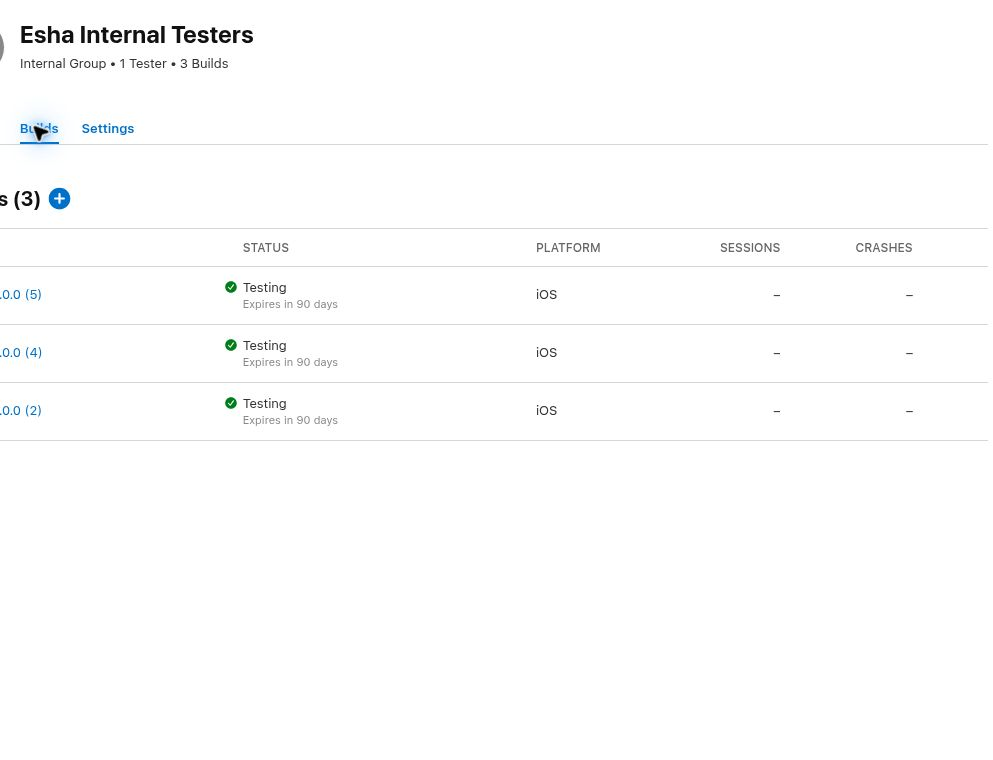

# Esha selfie preview — release checkpoint

**Released to internal TestFlight · 16 November 2026**

The selfie feature is available in **Esha 1.0.0 (5)**. Apple finished processing the signed package and the existing **Esha Internal Testers** group shows build 5 as **Testing**, alongside builds 4 and 2. The group still has one existing tester. All three source-pinned CI jobs passed, the downloaded signed package matches its verification receipt, and the matching production privacy notice is live.

The complete release record is [selfie-release-checkpoint-20261116.json](selfie-release-checkpoint-20261116.json). The remaining check is real-person alignment and interaction on a physical device after the user updates from build 4.

## What changes

**Try a Look** now invites the user to **Upload selfie** from the device photo picker. Lip color, satin/gloss finish and soft/wispy/bold lashes render over that photo locally. The original and overlays share the same contained image transform; the mouth opening is excluded from the lip mask, lashes follow the upper eye contours, and the face is not reshaped.

The card provides **Original / Try-on**, **Makeup strength**, **Change selfie**, **Remove photo** and **Cancel preview**. Saving a look keeps only the shade, finish and lash choices. The selfie, landmarks and strength setting are not saved with the look.

## How to try it

1. Open **TestFlight**, update Esha, and confirm the installed version is **1.0.0 (5)**.
2. Sign in and open **Try a Look → Upload selfie**.
3. Select a well-lit photo with one person looking ahead and with eyes and lips visible.
4. Try the existing shade, finish and lash choices. Tap **Original** to compare, return to **Try-on**, and adjust **Makeup strength**.
5. Use **Change selfie** to choose another photo or **Remove photo** to clear it. **Cancel preview** stops a pending preview.
6. Tap **Save this look** to retain the cosmetic settings in My Vanity. Confirm that signing out or switching accounts clears the photo preview.

Build 5 is available to the existing internal tester. Installation of this new build and successful real-person alignment on a physical device have not yet been observed.

## Privacy and practical limits

Photo normalization and landmark detection run on the device: Apple Vision on iOS and bundled Google ML Kit on Android. Esha does not upload the photo or facial landmarks, include them in AI consultations, or sync them to the account. The original gallery photo remains unchanged.

The preview is session-scoped. Normal operation attempts to delete the app-owned temporary picker copy after reading or discarding it. A crash or deletion failure can leave a copy in the app cache until the device clears it or the app is removed. Interrupted Android picker results are discarded, with cleanup attempted at the next startup.

Android ML Kit sends SDK diagnostics and usage metrics to Google separately from photo processing. These can include device/app information, installation identifiers, performance, configuration, input/output sizes, events and errors. “On device” does not mean the SDK sends no diagnostic data.

Effects are approximate: lighting, screens and real products can differ, and this is not an exact product-shade match. The feature does not identify people, infer skin tone or make health assessments. Paid AI and voice remain disabled.

## Evidence at this checkpoint

| Check | Result |
| --- | --- |
| Flutter tests | 126 passed |
| Flutter analyzer | No issues |
| Source identity check | Passed |
| Artifact privacy tests | 7 passed |
| Main-worktree and scoped-production policy tests | Passed |
| GitHub CI 43780984228 | All three jobs succeeded: Android, iOS simulator, backend/SQL |
| Signed build 5 / Apple upload | Verified App Store distribution package; Apple upload succeeded without errors |
| Apple processing and compliance | Complete; standard encryption category saved, France set to No |
| Internal TestFlight group | Build 1.0.0 (5) is Testing; one existing tester, three builds |
| Production policy | Exact source deployed LIVE; five public HTTP checks passed, privacy/terms match source |
| Real-person physical-device alignment | Not yet observed |

Source: local `d59b77b69de7be0aefd28b04a8d018911f1491ab`; remote `f125ff9fe2edb32ffbd54b86be1a7115f2deecd4`; tree `25ba94b5de476886c66516e361eb3a9f789129d3`.

Scoped production policy source: `eea73d13586a969a4502d9be1fc5da34707bc575`; tree `bb8df5dd72e175d780f18743ae572606cc7ea97e`.

## Release receipts

- [Cloud validation](https://github.com/digiplayja-design/Ai-wiz-command-center/actions/runs/43780984228) completed successfully at 00:42:25 UTC.
- [Signed release job](https://codemagic.io/app/6a32198d2d0806059c3df062/build/6afa4fb490e83b09c4fac9b4) finished in 6 minutes 59 seconds. Its [signature and identity receipt](Esha-signed-verification.json) identifies the exact compiled source above.
- The [independently downloaded IPA check](downloaded-ipa-check.json) confirms version 1.0.0, build 5, bundle identity, iOS 15.0 minimum and the photo-library purpose string. Its 48,499,696 bytes have SHA-256 `2afeb2c4a657a72d66438641ba7e1ca486036a5b9f2e24e81338eabb1add1cce`, matching the signed-build receipt.
- Apple upload delivery UUID: `a5df5481-2b40-4d6c-a2a8-904e595b31f5`. The upload log reported success without errors.
- [Production policy deployment evidence](production-policy-deploy-20261116.json) records Render deployment `dep-dbt4vp1srm7s73a891qg` as LIVE on the exact scoped source. The policy deploy does not change service configuration, account grants, billing or AI availability.
- [TestFlight group](https://appstoreconnect.apple.com/teams/f6169920-6326-4780-9d14-81013fac8eb0/apps/6835184869/testflight/groups/34951be9-1955-4e01-94da-778608de638f/builds) confirms internal availability. No external beta review or App Store review was submitted.

The proof below excludes the account header and tester contact details. Its left edge partially crops the version labels; the full **1.0.0 (5)** value and **Testing** status were also read from the live accessibility state and recorded in the checkpoint.

