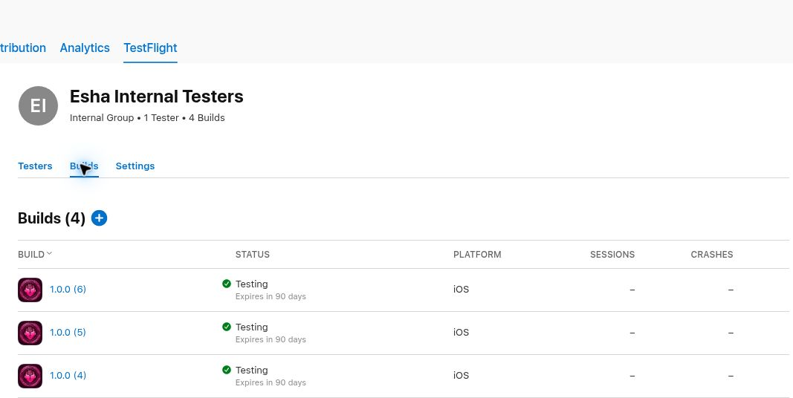

# Selfie display fix — TestFlight build 6

**Released to Esha Internal Testers · 16 November 2026 · 1.0.0 (6)**

Build **1.0.0 (6)** is marked **Testing** in the existing **Esha Internal Testers** group. It fixes the failure where selecting a photo produced “Choose a closer selfie” while the preview remained empty. All **146 Flutter tests** passed, analysis reported no issues, and Android, iOS Simulator and backend CI completed successfully. The signed iPhone package was independently downloaded and verified, uploaded successfully to Apple, and assigned to the existing internal group after compliance was saved with **France: No**.

The user's original selected photo has not yet been retested on their physical device with build 6. TestFlight availability and automated regression results do not establish that physical-device result.

## What changed

In build 5, the Dart validator required a detected face to occupy at least 15% of the image width and 18% of its height. An alignment exception disposed the decoded photo before the controller could display it. This made a makeup-alignment failure also prevent the original photo from appearing. The native coordinate conversion was reviewed and found correct.

Build 6 separates **showing the photo** from **applying makeup**. Once decoding and input validation succeed, an independently owned image clone is displayed immediately while landmark detection continues. An alignment failure keeps the original visible and explains why makeup is not applied.

The relative face-size cutoff is removed. Single-face, pose, image-dimension, bounds, coordinate and complete-landmark validation remain in place. Invalid or undecodable input can still produce an error. Makeup placement is enabled only when the landmarks are usable.

Without alignment, the preview says **“Original photo. Makeup is not applied.”** and retains **Change selfie** and **Remove photo**. **Cancel preview** remains available while processing. Try-on and strength controls appear when alignment is usable. The painter independently skips makeup without landmarks; successful aligned previews retain their existing controls and rendering.

Cancellation, sign-out, account changes and access resets invalidate pending work. Late results cannot restore a cancelled photo or a photo from a previous account.

## Try the update

1. Open **TestFlight**, update Esha and confirm **1.0.0 (6)**.
2. Open **Try a Look → Upload selfie** and choose the photo again.
3. Confirm the original photo appears while alignment runs.
4. If a warning appears, confirm the photo remains visible with **“Original photo. Makeup is not applied.”** Try **Change selfie** or **Remove photo**.
5. If alignment succeeds, compare **Original / Try-on** and use strength, shade, finish and lash controls.

These are user-device validation instructions. The original photo was not available to the investigation and has not been tested on the user's phone by this release process.

## Verified release evidence

| Check | Result |
| --- | --- |
| Full Flutter suite | **146 passed** |
| Full Flutter analyzer | **No issues** |
| Source identity check | Passed |
| Native coordinate audit | Reviewed; the identified rejection was in Dart validation |
| [GitHub CI 43783335126](https://github.com/digiplayja-design/Ai-wiz-command-center/actions/runs/43783335126) | All three jobs succeeded: Android, iOS Simulator, backend and SQL |
| [Codemagic signed build 6](https://codemagic.io/app/6a32198d2d0806059c3df062/build/6afa550590e83b09c4facaf7) | Finished in 6m 48s |
| Downloaded signed IPA | Exact bundle, version 1.0.0, build 6, byte count and SHA-256 verified |
| Apple upload | `UPLOAD SUCCEEDED with no errors`, 2026-11-16T01:04:37.281Z |
| Compliance | Saved for build 6; **France: No** |
| Existing internal group | **Esha Internal Testers**, build **1.0.0 (6)** marked **Testing** |
| User's original-photo physical-device retest | Not yet observed |

The image below is a live App Store Connect capture of the existing group's build table. Its first row confirms the exact released version and Testing state.

The exact build advanced through Missing Compliance and Ready to Submit before its group row showed Testing. That final state verifies eligibility and availability for internal testing. The separate Build Uploads collection was not reread as Complete.

### Source and package identity

- Released remote source: `c1c9b41d2300605db71dd8f6dc70be3bf217078a`
- Local source commit: `bdab28d4289fe81698c2a370fc5d5f6d5f875e21`
- Matching source tree: `cd87df0ee27b38b73a441a053718bdef019a630a`
- Bundle: `com.korlixdeveloper.esha`
- Apple app: `6835184869`
- Apple build and upload delivery UUID: `15b56e18-eb4c-4f1e-beaa-958715e2feb3`
- Signed IPA size: **48,501,009 bytes**
- Signed IPA SHA-256: `d280774834b149d45ed04f7dae8c8fac0f8a6b2c6bea2bb052a1f4d4c7240c9d`

Receipts: [release checkpoint](selfie-display-fix-checkpoint-20261116.json), [signed artifact verification](Esha-signed-verification.json), and [independent downloaded IPA check](downloaded-ipa-check.json).

The signed artifact receipt was created before publishing, so its `submitted_to_store: false` field remains an accurate snapshot of that stage. The separate upload record in the release checkpoint verifies subsequent delivery. Android and simulator artifact hashes are GitHub API metadata, not independent download-and-rehash results.

## Scope and privacy

Photo and landmark processing remain on device, with no photo or landmark upload or account sync. The gallery original remains unchanged. Existing temporary-file handling and SDK-diagnostic disclosures continue to apply.

The investigation used the supplied error screenshot, source inspection and tests with synthetic image data. The original selected photo was not accessed or copied, and the supplied attachment is not included in this release folder.

This fix does not change the backend or privacy policy, activate AI or voice, send tester invitations, or submit an external beta or App Store review. Historical build-5 evidence remains unchanged.
